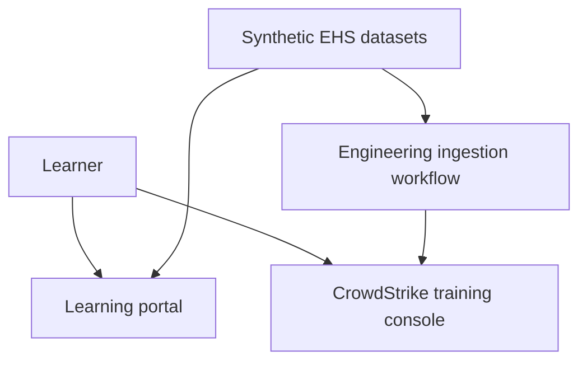

# ECA Cyber Range — Project Showcase

**An interactive learning portal that connects guided cybersecurity practice with investigation work in CrowdStrike Falcon Next-Gen SIEM.**

Developed for Ellington Cyber Academy (ECA), the portal uses a fictional healthcare client, **Ellington Health Systems (EHS)**, to give learners a consistent setting for reviewing events, collecting evidence, documenting findings, and preparing an investigation handoff.

This repository documents the product and April Walker's work on it. Application source, full training datasets, assessment keys, and paid learning materials are excluded.

## The problem

Access to a security console alone does not give a beginning analyst a clear learning path. Learners also need context: what to investigate, which records support a conclusion, how to distinguish expected activity from suspicious behavior, and how to communicate their findings.

The portal brings those steps into a repeatable workflow alongside a separate CrowdStrike training environment.

## Current MVP

| Capability | Current behavior |
|---|---|
| Guided simulations | Five scenario-based activities covering authentication, administrative baselines, clinical documents, billing detections, and HR file access |
| Evidence lab | Filters original synthetic event records by time, account, event category, outcome, and text; supports record inspection and evidence pinning |
| Guided walkthroughs | Two written Falcon walkthroughs aligned to the billing and clinical scenarios |
| Investigation workflow | Briefing, evidence review, guided tasks, written findings, and handoff |
| Knowledge checks | Six multiple-choice questions after each simulation handoff, with feedback and retry support |
| Learner progress | Browser-local profiles, saved findings, notes, evidence selections, and quiz progress |
| Presentation | Responsive HTML, CSS, and JavaScript interface with light and dark themes |

The learning portal and the Falcon console are separate applications used together. The portal's evidence lab displays synthetic records locally; it does not execute live Falcon queries or embed the Falcon console.

## How the pieces fit

The portal activities use selected datasets from the same engineering dataset package prepared for ingestion into CrowdStrike. Matching scenario records lets the instructional experience and console investigation refer to the same evidence. Console ingestion and provisioning are managed separately.

## My contribution

**April Walker — Product planning, technical program management, and learning experience design**

- Defined the learner journey and the relationship between the portal, training datasets, and CrowdStrike environment.
- Directed iterative development of the interactive HTML MVP using AI-assisted implementation.
- Shaped evidence review, guided investigation tasks, written findings, and handoff activities.
- Requested scenario-aligned knowledge checks with explanations and retry support.
- Planned membership access, persistent student records, and a path from the prototype to a hosted learning product.

This project reflects product decisions, technical coordination, curriculum design, and iterative review. AI-assisted implementation is part of the development workflow.

## Current limits and next steps

The MVP currently saves progress in the learner's browser. Its name-based profile selector is **not authenticated access**, and progress is not yet synchronized across devices.

Planned work includes:

- Supabase authentication and database-backed progress.
- Membership-based authorization and an administrative access workflow.
- Independent website hosting and an ECA subdomain.
- Activity-level and learning-path reset controls.

These capabilities are planned; they are not presented as completed features. CrowdStrike accounts and permissions remain a separate access responsibility.

## Portfolio scope

This showcase intentionally contains documentation rather than the full application. Screenshots and additional design notes can be added as the presentation evolves.

**Organization:** Ellington Cyber Academy  
**Scenario client:** Ellington Health Systems (fictional)  
**Project owner for this portfolio:** [April Walker](https://github.com/awalker816)

CrowdStrike and Falcon are trademarks of their respective owner. This project does not claim vendor endorsement.
